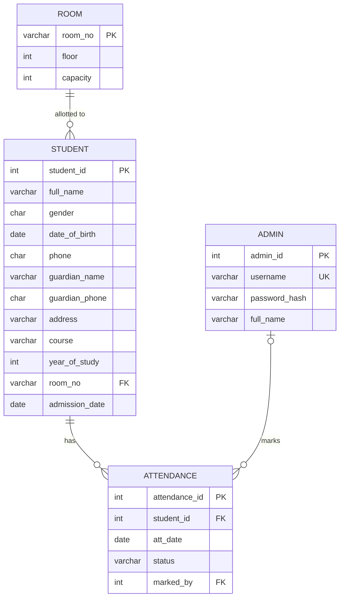

# Database Design: Government Hostel Management System

This file has three parts:
1. ER diagram (entities, attributes, relationships)
2. Relational schema (tables, keys, constraints)
3. Normalization proof (1NF, 2NF, 3NF)

---

## Part 1: ER Diagram

### 1.1 Entities and attributes

| Entity | Key attribute | Other attributes | Derived attributes (not stored) |
|--------|---------------|------------------|---------------------------------|
| ADMIN | admin_id | username, password_hash, full_name | - |
| ROOM | room_no | floor, capacity | occupied_beds (COUNT of students) |
| STUDENT | student_id | full_name, gender, date_of_birth, phone, guardian_name, guardian_phone, address, course, year_of_study, admission_date | age (from date_of_birth), attendance_percentage |
| ATTENDANCE | attendance_id | att_date, status | - |

**Derived attributes** are calculated when needed and never stored. Storing `age`
would make it wrong after the student's next birthday. Storing a percentage would
make it wrong after the next attendance entry.

### 1.2 Relationships and cardinality

| Relationship | Between | Cardinality | Meaning |
|--------------|---------|-------------|---------|
| ALLOTTED_TO | ROOM - STUDENT | 1 : N | One room holds 0 to 4 students. Each student lives in exactly 1 room. |
| HAS | STUDENT - ATTENDANCE | 1 : N | One student has many attendance entries, one per date. Each entry belongs to exactly 1 student. |
| MARKS | ADMIN - ATTENDANCE | 1 : N | One admin marks many entries. Each entry is marked by at most 1 admin. |

**ATTENDANCE is a weak-like entity.** It has no meaning without a student.
For that reason, deleting a student also deletes their attendance (ON DELETE CASCADE).

### 1.3 ER diagram (Mermaid)

To render it, paste this block into https://mermaid.live. GitHub also renders it
automatically when you view this file there.



How to read the crow's-foot symbols:
`||` means exactly one, `o{` means zero or many, and `|o` means zero or one.

### 1.4 Text version (for drawing by hand in the report)

```
 +--------+  1      allotted to     N  +-----------+  1     has     N  +--------------+
 |  ROOM  |----------------------------|  STUDENT  |-------------------|  ATTENDANCE  |
 +--------+   (max 4 per room)         +-----------+                   +--------------+
                                                                          | N
                                                                          | marks
                                                                          | 1
                                                                       +--------+
                                                                       | ADMIN  |
                                                                       +--------+
```

---

## Part 2: Relational Schema

Notation: **bold** = primary key, *italic* = foreign key.

```
ADMIN      ( **admin_id**, username, password_hash, full_name )
ROOM       ( **room_no**, floor, capacity )
STUDENT    ( **student_id**, full_name, gender, date_of_birth, phone,
             guardian_name, guardian_phone, address, course,
             year_of_study, *room_no*, admission_date )
ATTENDANCE ( **attendance_id**, *student_id*, att_date, status, *marked_by* )
```

### 2.1 ADMIN
| Column | Type | Constraints | Reason |
|--------|------|-------------|--------|
| admin_id | INT | PRIMARY KEY, AUTO_INCREMENT | Surrogate key |
| username | VARCHAR(30) | NOT NULL, UNIQUE | Two admins cannot share a login name |
| password_hash | VARCHAR(64) | NOT NULL | We store a SHA-256 hash, never the plain password |
| full_name | VARCHAR(60) | NOT NULL | Shown on screen after login |

### 2.2 ROOM
| Column | Type | Constraints | Reason |
|--------|------|-------------|--------|
| room_no | VARCHAR(10) | PRIMARY KEY | Natural key, e.g. 'A101' |
| floor | INT | NOT NULL, CHECK (floor BETWEEN 0 AND 5) | Ground floor = 0 |
| capacity | INT | NOT NULL, DEFAULT 4, CHECK (capacity BETWEEN 1 AND 4) | Room size rule |

### 2.3 STUDENT
| Column | Type | Constraints | Reason |
|--------|------|-------------|--------|
| student_id | INT | PRIMARY KEY | Hostel-issued ID, entered by the warden |
| full_name | VARCHAR(60) | NOT NULL, CHECK (TRIM(full_name) <> '') | Name cannot be blank |
| gender | CHAR(1) | NOT NULL, CHECK (gender IN ('M','F','O')) | Fixed set of values |
| date_of_birth | DATE | NOT NULL | DATE type rejects invalid dates such as 2026-02-30 |
| phone | CHAR(10) | NOT NULL, UNIQUE, CHECK (phone REGEXP '^[0-9]{10}$') | Exactly 10 digits |
| guardian_name | VARCHAR(60) | NOT NULL | |
| guardian_phone | CHAR(10) | NOT NULL, CHECK (guardian_phone REGEXP '^[0-9]{10}$') | Not UNIQUE: two siblings can share a guardian |
| address | VARCHAR(200) | NOT NULL | |
| course | VARCHAR(40) | NOT NULL | e.g. 'B.Tech AIML' |
| year_of_study | INT | NOT NULL, CHECK (year_of_study BETWEEN 1 AND 5) | |
| room_no | VARCHAR(10) | NOT NULL, FOREIGN KEY -> ROOM(room_no) ON DELETE RESTRICT ON UPDATE CASCADE | See note 1 |
| admission_date | DATE | NOT NULL | |

### 2.4 ATTENDANCE
| Column | Type | Constraints | Reason |
|--------|------|-------------|--------|
| attendance_id | INT | PRIMARY KEY, AUTO_INCREMENT | Surrogate key |
| student_id | INT | NOT NULL, FOREIGN KEY -> STUDENT(student_id) ON DELETE CASCADE | Delete a student and their attendance goes with them |
| att_date | DATE | NOT NULL | See note 2 |
| status | VARCHAR(7) | NOT NULL, CHECK (status IN ('Present','Absent','Leave')) | Only three allowed values |
| marked_by | INT | NULL, FOREIGN KEY -> ADMIN(admin_id) ON DELETE SET NULL | Keeps the record even if the admin account is removed |
| (table) | | UNIQUE (student_id, att_date) | One entry per student per day |

### 2.5 Design notes (good viva points)

1. **Why Student → Room uses ON DELETE RESTRICT and not CASCADE.**
   With CASCADE, deleting room A101 would silently delete the four students living
   in it. RESTRICT blocks the room delete until those students are moved. CASCADE
   is used only where the child truly cannot exist without the parent
   (Attendance → Student).
2. **Why `att_date` and not `date`.** `DATE` is a MySQL keyword. Using it as a
   column name works but causes confusing errors. A clear name avoids this.
3. **Business rules that one CHECK cannot enforce.** These need a trigger in Stage 2:
   - At most 100 rows in STUDENT. A CHECK only sees one row, so it cannot count rows.
   - Room occupancy at most capacity. This needs a COUNT over other rows.
4. **Attendance percentage definition (used from Stage 4):**
   `percentage = (Present days / total days marked for that student) × 100`.
   Leave counts as a working day but not as present. If your college treats Leave
   differently, it is a one-line change in the view.
5. **Indexes planned for Stage 2:**
   - `STUDENT(full_name)`, for name searches with LIKE.
   - `ATTENDANCE(att_date)`, for "view by date" and "view by month".
   - PRIMARY KEY and UNIQUE columns are indexed automatically, so
     `(student_id, att_date)` is already covered.

---

## Part 3: Normalization Proof

### 3.0 Starting point: the paper register (unnormalized, UNF)

A warden's register often looks like this. Each student is one row, and attendance
is crammed into it.

| student_id | full_name | phone | guardian | room_no | room_floor | room_capacity | attendance |
|-----------|-----------|-------|----------|---------|------------|---------------|------------|
| 101 | Ravi Patil | 98xxxxxx01 | S. Patil | A101 | 1 | 4 | 01-Oct P, 02-Oct A, 03-Oct L |
| 102 | Amit Kale | 98xxxxxx02 | R. Kale | A101 | 1 | 4 | 01-Oct P, 02-Oct P |

Problems with this table:
- **Repeating group:** the `attendance` cell holds many values.
- **Redundancy:** the floor and capacity of A101 are repeated for every student in it.
- **Update anomaly:** if A101's capacity changes, every row with A101 must be edited.
- **Insert anomaly:** a new empty room cannot be recorded until a student lives in it.
- **Delete anomaly:** deleting the only student in a room also loses the room's details.

### 3.1 First Normal Form (1NF)

**Rule:** every cell holds a single (atomic) value, and there are no repeating groups.

**Step:** move attendance into its own table, with one row per student per date.

```
STUDENT_ROOM ( student_id, full_name, phone, guardian..., room_no, room_floor, room_capacity )
ATTENDANCE   ( student_id, att_date, status )        key = (student_id, att_date)
```

Every column is now atomic. Address is kept as one value, because we never search
inside it by city or PIN. Splitting it would be needed only if we did.

### 3.2 Second Normal Form (2NF)

**Rule:** the table is in 1NF, and no non-key column depends on only *part* of a
composite key (no partial dependency).

- `STUDENT_ROOM` has a single-column key, `student_id`. A partial dependency is
  impossible, so it is already in 2NF.
- `ATTENDANCE` has the composite key `(student_id, att_date)`. Its only non-key
  column is `status`, which needs both parts: a student's status depends on which
  day it is. There is no partial dependency, so it is in 2NF.

We then add a surrogate key `attendance_id` for convenience, and keep
`UNIQUE(student_id, att_date)` so the real rule is still enforced.

### 3.3 Third Normal Form (3NF)

**Rule:** the table is in 2NF, and no non-key column depends on another non-key
column (no transitive dependency).

In `STUDENT_ROOM` there is one:

```
student_id → room_no → room_floor, room_capacity
```

`room_floor` and `room_capacity` describe the **room**, not the student.

**Step:** move them into a separate ROOM table and keep only `room_no` as a
foreign key in STUDENT.

```
ROOM    ( room_no, floor, capacity )
STUDENT ( student_id, full_name, ..., room_no )
```

This removes all three anomalies listed in 3.0. Room details are stored once,
an empty room can exist, and deleting a student does not lose the room.

### 3.4 Final check, table by table

| Table | Functional dependencies | 1NF | 2NF | 3NF |
|-------|-------------------------|-----|-----|-----|
| ADMIN | admin_id → username, password_hash, full_name; username → admin_id | Atomic values | Single-column key | No non-key → non-key dependency. username is a candidate key, so username → other columns is allowed |
| ROOM | room_no → floor, capacity | Atomic | Single-column key | floor and capacity depend only on room_no |
| STUDENT | student_id → all other columns; phone → student_id (phone is UNIQUE) | Atomic | Single-column key | Room details removed. phone is a candidate key, not an ordinary non-key column. Age and percentage are not stored |
| ATTENDANCE | attendance_id → student_id, att_date, status, marked_by; (student_id, att_date) → status, marked_by | Atomic, one row per day | status depends on the full (student_id, att_date) | No non-key → non-key dependency |

**Note on guardian columns:** `guardian_name` and `guardian_phone` could form a
separate GUARDIAN table if guardians were shared or had many attributes. For this
hostel, each student has one guardian contact, and the extra table would add a
join without real benefit. This is a deliberate, explainable design choice.

**Result:** all four tables are in **3NF**. They are also in **BCNF**, because
every determinant (admin_id, username, room_no, student_id, phone, attendance_id,
(student_id, att_date)) is a candidate key.
